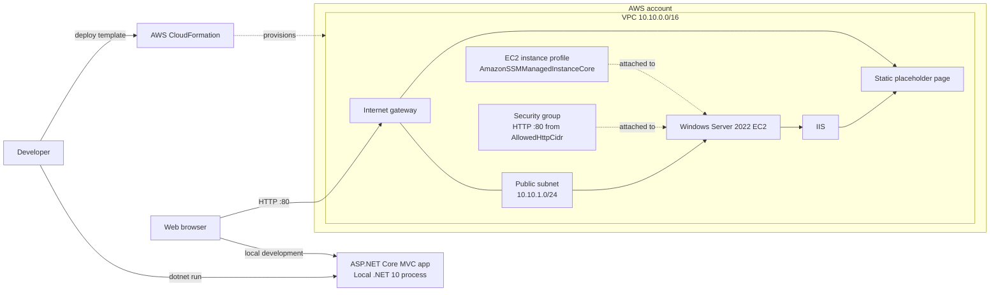
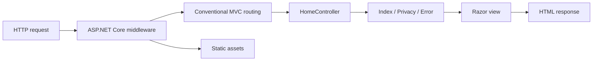

# Project Architecture

## Overview

The repository contains two related but currently separate parts:

1. An ASP.NET Core MVC application targeting .NET 10.
2. An AWS CloudFormation template that provisions a Windows Server 2022 EC2
   instance with IIS.

The CloudFormation stack does not currently build, publish, or deploy the MVC
application. After the stack is created, IIS serves a static placeholder page
written by EC2 user data. The application's home page describes the intended
demo, but that does not indicate that the app is running on the EC2 instance.

## System context



The local application and the EC2-hosted IIS placeholder are separate runtime
paths. No deployment connection currently transfers the application from the
developer or repository to EC2.

## Application architecture

The application project is in
[`application/WindowsWebApp`](../application/WindowsWebApp/WindowsWebApp.csproj).
It uses the ASP.NET Core MVC pattern:



- [`Program.cs`](../application/WindowsWebApp/Program.cs) registers MVC,
  configures the middleware pipeline, maps static assets, and sets the
  conventional route. The default route is
  `/{controller=Home}/{action=Index}/{id?}`.
- [`HomeController.cs`](../application/WindowsWebApp/Controllers/HomeController.cs)
  supplies the Home, Privacy, and Error actions.
- Razor views are under `application/WindowsWebApp/Views`; browser assets and
  vendor libraries are under `application/WindowsWebApp/wwwroot`.
- The project targets `net10.0`, enables nullable reference types, and uses
  implicit usings.
- The configured local HTTP launch URL is `http://localhost:5062`.

For local development, restore and run the project from the repository root:

```powershell
dotnet restore .\application\WindowsWebApp\WindowsWebApp.csproj
dotnet run --project .\application\WindowsWebApp\WindowsWebApp.csproj
```

## AWS infrastructure architecture

The infrastructure is defined in
[`infrastructure/cloudformation/main.yaml`](../infrastructure/cloudformation/main.yaml).
CloudFormation provisions:

1. A VPC with DNS support and hostnames enabled.
2. One public subnet in the first available Availability Zone, with public IP
   assignment enabled.
3. An internet gateway, its VPC attachment, a route table, and a default
   internet route associated with the subnet.
4. A security group allowing inbound TCP port 80 from `AllowedHttpCidr`.
5. An IAM role and instance profile granting
   `AmazonSSMManagedInstanceCore` to the EC2 instance.
6. A Windows Server 2022 EC2 instance using the current AWS-published AMI
   resolved through the SSM public parameter
   `/aws/service/ami-windows-latest/Windows_Server-2022-English-Full-Base`.
7. EC2 user data that installs the IIS Web Server role, creates
   `C:\inetpub\wwwroot\index.html` with a readiness message, and starts IIS.

The template accepts `InstanceType` (default `t3.small`) and `AllowedHttpCidr`
(default `0.0.0.0/0`). Its outputs include the instance ID, public IP, HTTP
website URL, VPC ID, and subnet ID.

## Provisioning and runtime flow

1. An operator deploys the CloudFormation template with the AWS CLI and
   supplies the stack name and any parameter overrides.
2. CloudFormation creates the network, IAM instance profile, and EC2
   resources.
3. On startup, EC2 user data installs IIS and writes the placeholder page.
4. A browser reaching the instance's public DNS name over HTTP port 80 receives
   the IIS placeholder page.
5. Separately, a developer can run the MVC application locally using the .NET
   SDK; it is not part of the infrastructure deployment flow.

## Boundaries and current limitations

- There is no configured CI/CD path. The files under `.github/workflows` and
  `infrastructure/scripts` are currently empty.
- The EC2 bootstrap does not install the .NET runtime or hosting bundle,
  publish the MVC project, configure IIS for ASP.NET Core, or transfer
  application artifacts.
- The template allows public HTTP by default. Override `AllowedHttpCidr` with a
  trusted source range; the template does not configure HTTPS, TLS termination,
  or a custom domain.
- The instance is placed in a public subnet and receives a public IP. SSM
  permissions are attached, but actual management connectivity depends on the
  instance having network access to Systems Manager endpoints.
- The template is a demo baseline rather than a production topology; it does
  not define high availability, autoscaling, monitoring, or deployment
  rollback for application releases.

## Related documentation

- [Project README](../README.md) for prerequisites and deploy/run commands.
- [CloudFormation template](../infrastructure/cloudformation/main.yaml) for
  the authoritative resource definitions.